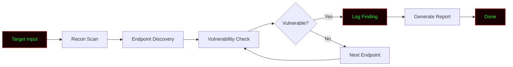

# heXtrike
<!-- ═══════════════════════════════════════════════════════════════════════ -->
<!--                        HEXTRIKE - README.md                             -->
<!--              Professional Hacking Toolkit Documentation                 -->
<!-- ═══════════════════════════════════════════════════════════════════════ -->

<div align="center">

# ⚡ heXtrike

### `Exploit • Scan • Dominate`

**A Python-based hacking toolkit for security researchers and bug bounty hunters.**

[](https://github.com/anonmoty/heXtrike)
[](https://python.org)
[](LICENSE)
[](https://github.com/anonmoty/heXtrike)
[](https://github.com/anonmoty/heXtrike)

</div>


---

```
████████████████████████████████████████████████████████████████████████
█                                                                      █
█   ██╗  ██╗███████╗██╗  ██╗████████╗██████╗ ██╗██╗  ██╗███████╗        █
█   ██║  ██║██╔════╝╚██╗██╔╝╚══██╔══╝██╔══██╗██║██║ ██╔╝██╔════╝        █
█   ███████║█████╗   ╚███╔╝    ██║   ██████╔╝██║█████╔╝ █████╗          █
█   ██╔══██║██╔══╝   ██╔██╗    ██║   ██╔══██╗██║██╔═██╗ ██╔══╝          █
█   ██║  ██║███████╗██╔╝ ██╗   ██║   ██║  ██║██║██║  ██╗███████╗        █
█   ╚═╝  ╚═╝╚══════╝╚═╝  ╚═╝   ╚═╝   ╚═╝  ╚═╝╚═╝╚═╝  ╚═╝╚══════╝        █
█                                                                      █
█                    [ Exploit | Scan | Dominate ]                     █
█                                                                      █
████████████████████████████████████████████████████████████████████████
```

---

## ⚠️ Disclaimer

```
╔══════════════════════════════════════════════════════════════════════╗
║                                                                      ║
║   HEXTRIKE is built for EDUCATIONAL and AUTHORIZED testing only.     ║
║                                                                      ║
║   ▸ Use ONLY on systems you own or have permission to test.          ║
║   ▸ Unauthorized exploitation is ILLEGAL.                            ║
║   ▸ Follow bug bounty scope and local laws at all times.             ║
║   ▸ The author is NOT responsible for any misuse.                    ║
║                                                                      ║
║   Hack responsibly. Hunt ethically. Report responsibly.              ║
║                                                                      ║
╚══════════════════════════════════════════════════════════════════════╝
```

---

## 🎯 What Is heXtrike?

**heXtrike** is a Python-based **hacking toolkit** designed for **bug bounty hunters, penetration testers, and security researchers**. It combines multiple offensive security modules into one streamlined framework — with a clean, hacker-style terminal interface.

Whether you're hunting XSS, SQLi, or hidden endpoints — heXtrike gives you the **edge you need**.

---

## ✨ Features

```
┌─────────────────────────────────────────────────────────────────────┐
│  [01] 🔍 Recon Scanner       → Endpoint discovery                   │
│  [02] 🛡️ Vulnerability Scan  → XSS, SQLi, LFI checks                │
│  [03] 🌐 Site Crawler        → Maps internal/external links          │
│  [04] 📡 DNS Lookup          → Resolves DNS records                  │
│  [05] 🧪 Payload Generator   → Custom attack payloads                │
│  [06] ⚡ Multi-Threaded      → Fast parallel scanning                │
│  [07] 📊 Progress Bar        → Real-time terminal feedback           │
│  [08] 📝 JSON Reports        → Structured, machine-readable output   │
│  [09] 🎨 Hacker Terminal UI  → Red + Green aesthetic                 │
│  [10] 🧰 Modular Design      → Extend with your own modules          │
└─────────────────────────────────────────────────────────────────────┘
```

---

## 🚀 Installation

```bash
# Clone the repo
git clone https://github.com/anonmoty/heXtrike.git
cd heXtrike

# Install dependencies
pip install -r requirements.txt

# Run
python heXtrike.py 
```

**One-liner:**

```bash
git clone https://github.com/anonmoty/heXtrike.git && cd heXtrike && pip install -r requirements.txt && python hextrike.py --help
```

---

## 🎯 Usage

```bash
# Recon scan
python hextrike.py --target https://example.com --recon

# Vulnerability scan
python hextrike.py --target https://example.com --vuln

# Full attack mode
python hextrike.py --target https://example.com --full --threads 20 \
                   --output reports/scan.json --verbose
```

### CLI Flags

```
┌─────────────────────────────────────────────────────────────────────┐
│  --target       →  Target URL                                       │
│  --recon        →  Run recon scan                                   │
│  --vuln         →  Run vulnerability scan                           │
│  --full         →  Full attack mode                                 │
│  --threads      →  Number of threads (default: 10)                  │
│  --output       →  Report output path                               │
│  --verbose      →  Verbose logging                                  │
│  --help         →  Show help                                        │
└─────────────────────────────────────────────────────────────────────┘
```

---

## 🧠 How It Works



1. **Input** — Takes target URL
2. **Recon** — Gathers information
3. **Discovery** — Finds hidden endpoints
4. **Scan** — Tests for vulnerabilities
5. **Report** — Outputs structured findings

---

## 📁 Structure

```
heXtrike/
├── hextrike.py
├── core/
│   ├── scanner.py
│   ├── crawler.py
│   ├── analyzer.py
│   └── reporter.py
├── payloads/
│   ├── xss.txt
│   ├── sqli.txt
│   └── lfi.txt
├── reports/
├── tests/
├── requirements.txt
├── LICENSE
└── README.md
```

---

## 📸 Demo

```
██████████████████████████████████████████████████████████████████████
█                                                                    █
█   HEXTRIKE v1.0.0                                                  █
█   ───────────────────────────────────────────────────────────      █
█                                                                    █
█   [✓] Target: https://example.com                                  █
█   [✓] Mode: Full Attack                                            █
█   [✓] Threads: 20                                                  █
█   [→] Scanning...                                                  █
█                                                                    █
█   [████████████████████████░░░░░░] 80%                             █
█                                                                    █
█   [!] VULNERABLE: /admin                                           █
█   [!] VULNERABLE: /debug                                           █
█   [✓] Scan complete in 4.32s                                       █
█   [✓] Report: reports/scan_2024.json                               █
█                                                                    █
█                     Happy Hunting! 🎯                              █
█                                                                    █
██████████████████████████████████████████████████████████████████████
```

---

## 🛠️ Requirements

```txt
requests>=2.28.0
beautifulsoup4>=4.11.0
colorama>=0.4.6
tqdm>=4.65.0
rich>=13.0.0
```

```bash
pip install -r requirements.txt
```

---

## 🎨 Terminal Theme

heXtrike uses a **red + green** hacker palette:

```python
THEME = {
    "primary":   "\033[38;5;196m",  # Bright Red
    "secondary": "\033[38;5;46m",   # Matrix Green
    "accent":    "\033[38;5;214m",  # Amber
    "error":     "\033[38;5;196m",  # Red
    "warning":   "\033[38;5;220m",  # Yellow
    "info":      "\033[38;5;46m",   # Green
    "reset":     "\033[0m",
}
```

---

## 🔥 Power Tips

```bash
# heXtrike + subfinder
subfinder -d target.com | httpx | while read url; do
    python hextrike.py --target "$url" --recon
done

# heXtrike + nuclei
python hextrike.py --target https://example.com --full -o scan.json
nuclei -u https://example.com -t ~/nuclei-templates/
```

---

## 🐛 Bug Bounty Workflow

```
██████████████████████████████████████████████████████████████████████
█                                                                    █
█   [01] Subdomain Enumeration  →  amass / subfinder                 █
█   [02] Live Host Detection    →  httpx                             █
█   [03] Recon & Scan           →  heXtrike  ← you are here          █
█   [04] Endpoint Analysis      →  grep, waybackurls                 █
█   [05] Vulnerability Scanning →  nuclei, XSStrike                  █
█   [06] Manual Testing         →  Burp Suite                        █
█                                                                    █
██████████████████████████████████████████████████████████████████████
```

### Use Cases

- 🔍 **Recon** on any target
- 📜 **Endpoint discovery** for hidden routes
- 🗺️ **Site crawling** for full attack surface
- 🧪 **Vulnerability simulation** in safe lab mode
- 📊 **Structured reports** for documentation

---

## 🗺️ Roadmap

```
┌─────────────────────────────────────────────────────────────────────┐
│  [x] Recon scanner                                                  │
│  [x] Vulnerability scan                                             │
│  [x] Site crawler                                                   │
│  [x] JSON reports                                                   │
│  [x] Hacker terminal UI                                             │
│  [ ] XSS detection module                                           │
│  [ ] SQLi detection module                                          │
│  [ ] LFI/RFI detection module                                       │
│  [ ] Wayback Machine integration                                    │
│  [ ] Docker image                                                   │
└─────────────────────────────────────────────────────────────────────┘
```

---

## 🤝 Contributing

1. Fork the repo
2. Create branch (`git checkout -b feature/amazing`)
3. Commit (`git commit -m 'Add amazing feature'`)
4. Push (`git push origin feature/amazing`)
5. Open Pull Request

---

## 📜 License

MIT License. See [`LICENSE`](LICENSE).

---

## 🙏 Credits

- **Author:** [@anonmoty](https://github.com/anonmoty)
- **Inspired by:** The offensive security community
- **Built with:** Python, caffeine, and curiosity ☕

---

<div align="center">

```
██████████████████████████████████████████████████████████████████████
█                                                                    █
█          ⚡  HACK RESPONSIBLY.  HUNT ETHICALLY.  DOMINATE.  ⚡       █
█                                                                    █
█                  ⭐  If this tool helped you, star it!  ⭐           █
█                                                                    █
██████████████████████████████████████████████████████████████████████
```

</div>
